<p align="center"></p>

<h1 align="center">Orbit Recorder</h1>

<p align="center">
  <b>Record calls, videos and voice notes. Make step-by-step guides. Send the notes wherever you work.</b><br>
  A free, open source Chrome extension. No account and no server of ours: everything stays in your browser until you send it.
</p>

<p align="center">
  <a href="https://github.com/tania-atomichr/orbit-recorder/actions/workflows/test.yml"></a>
  <a href="LICENSE"></a>
  
  
</p>

<p align="center">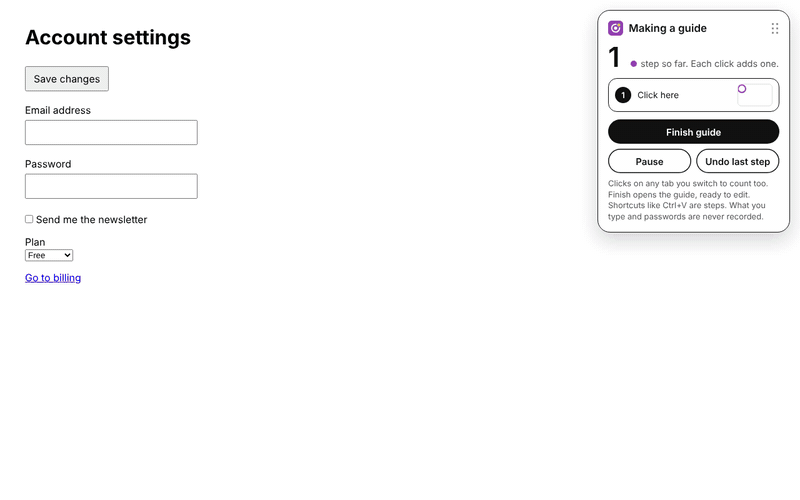</p>

## Why use it

| | |
|---|---|
| **Four tools in one** | Record a **call** (Meet, Zoom or Teams in the browser), a **video** of your screen with your face (like Loom), **audio** only, or a **step-by-step guide** (like Scribe). |
| **Notes that write themselves** | A transcript with who said what, a summary, next steps, ideas, chapters, who talked and how much, the mood, and the questions asked. Ask the recording a question and jump to the answer. |
| **Your keys, your services** | Deepgram, AssemblyAI, OpenAI Whisper or your own service for transcripts. Claude, anything OpenAI-compatible (OpenRouter, Ollama, LM Studio) or your own service for write-ups. Nothing goes through us. |
| **Ends up where you work** | Your own backend or web app (a signed webhook, with the recording if you want), Notion, Google Docs, Teamtailor, HubSpot, or anything Zapier or Make can reach. Or embed it in your own page with one tag. |
| **Private by default** | Nothing leaves the browser until you connect a place. Guides never record typing and paint out passwords. A trimmed recording sends only the part you kept, words included. |
| **Easy to change** | Plain JavaScript, no dependencies, no build step. MIT licence. |

Good for meeting notes, sales and discovery calls, interviews, support
calls, one-to-ones, quick video explainers, bug reports, onboarding and
how-to guides, and as a starting point for your own recorder.

## Quick start

1. **Get the code:** press the green **Code** button above, then
   **Download ZIP**, and unzip it. (Or `git clone` this repository.)
2. Open `chrome://extensions` in Chrome and turn on **Developer mode** (top right).
3. Press **Load unpacked** and pick the unzipped folder. A welcome page opens.
4. On the welcome page: pin the extension, allow the microphone (and the
   camera if you want your face in videos), and add a transcript service and
   a write-up service with your own keys.
5. Press the icon and pick **Record a call**, **Record a video**, **Record
   audio** or **Make a step-by-step guide**.

Guides work with no keys at all. Recordings are kept without keys too; you
need a transcript key for the words and a write-up key for the summary.

Tested in Chrome. It should also work in other Chromium browsers such as Edge
and Brave, but they are not tested yet.

## Contents

- [What it looks like](#what-it-looks-like)
- [Everything it does](#everything-it-does): [calls](#recording-a-call), [videos](#recording-a-video), [audio](#recording-audio), [guides](#making-a-step-by-step-guide), [the note page](#the-note-page), [the library](#the-library)
- [Connecting it to your own system](#connecting-it-to-your-own-system): [webhook](#your-own-backend-or-web-app-webhook), [Notion](#notion), [Google Docs](#google-docs), [Teamtailor](#teamtailor), [HubSpot](#hubspot), [embed](#embed-it-in-your-own-page), [add your own](#add-a-place-of-your-own)
- [Transcripts and write-ups](#transcripts-and-write-ups)
- [Privacy](#privacy) and [permissions](#permissions)
- [How it is built](#how-it-is-built), [Test](#test), [Contributing](#contributing) and [Licence](#licence)

## What it looks like

Every picture here comes from made-up data in the test run.

**On a call**, a card asks whether to record. One press records both sides;
the Video switch adds the picture.

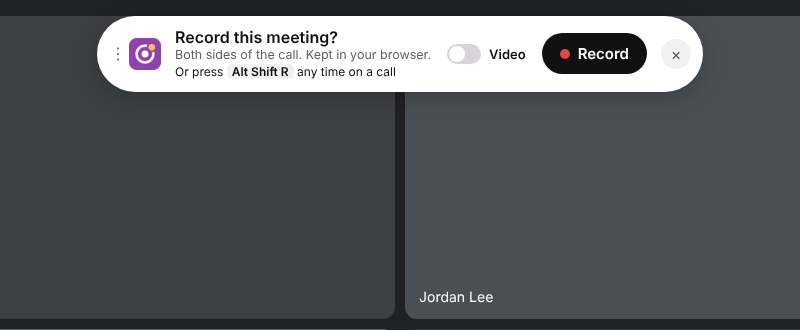

**While it records**, a bar shows the time, a level for you and one for
them, Pause, Note and Stop. With live words on, the last thing said shows
at the bottom.

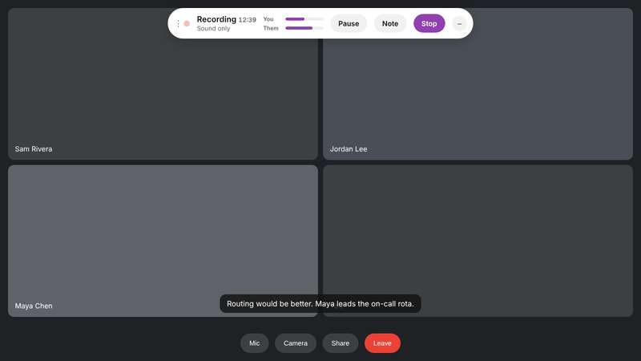

**The note** writes itself up when the call ends: the summary from a
template, next steps you can tick, who talked, the mood, ideas, chapters,
your own notes and the transcript.

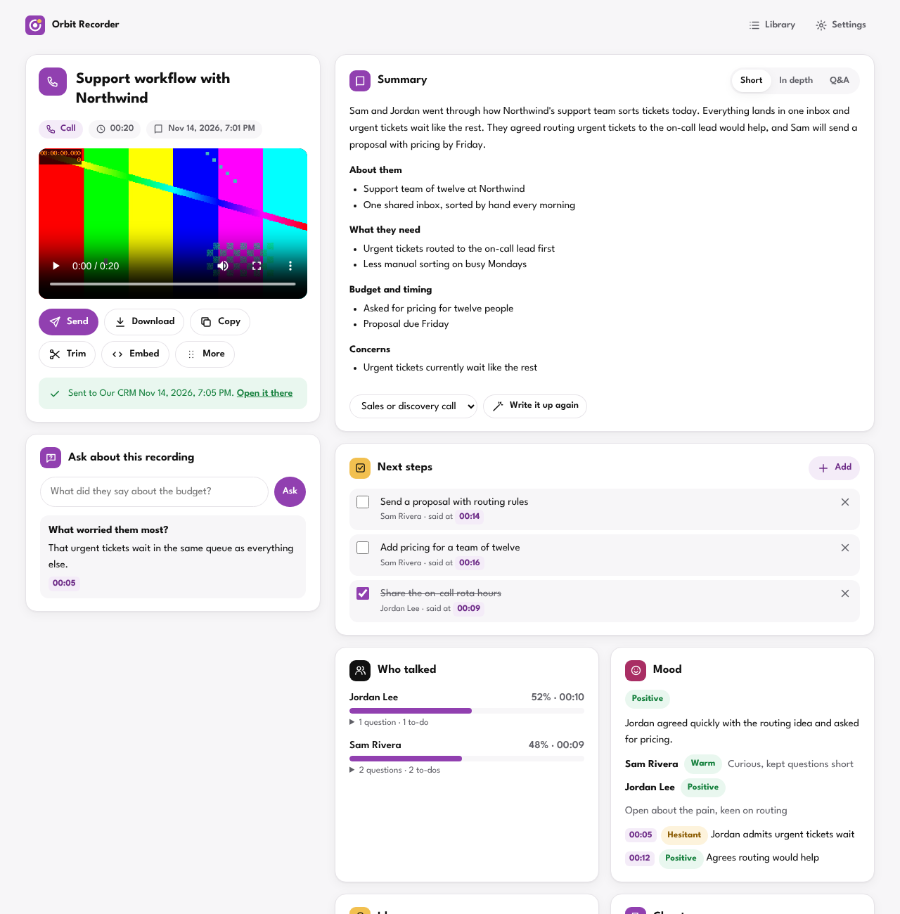

**Trim** keeps only the part you want, and only that part is sent.
**Send** goes to any place you connected and says where it went.

<p>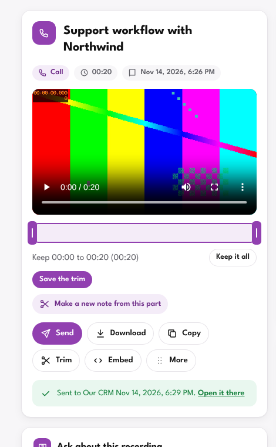 &nbsp; 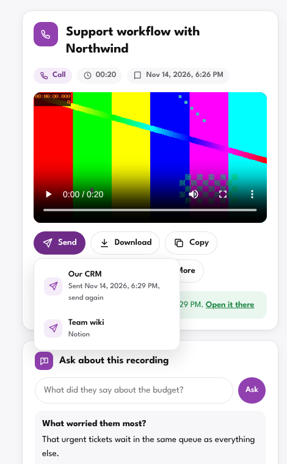</p>

**Making a guide.** A panel on the page counts the steps and shows the last
three. Every click is a step with a picture; what you type is never kept.

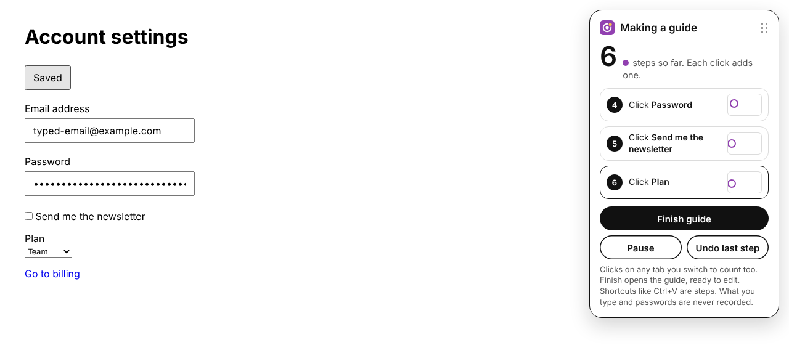

**The finished guide**, ready to edit: a sentence per step, the clicked
thing ringed, a tip under any step, reorder, add, take out, Write it for me.

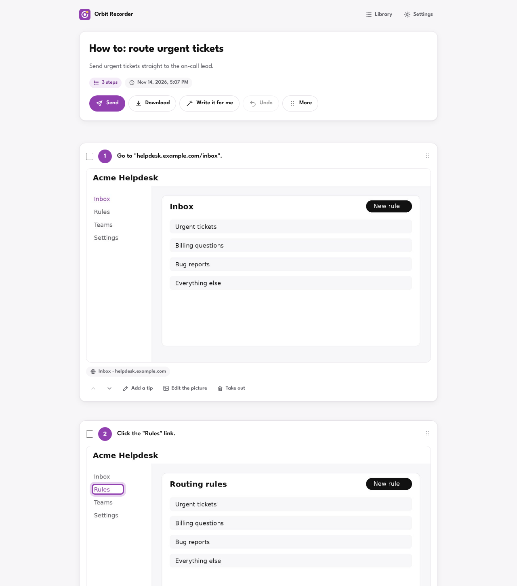

**The picture editor**: cover anything private, redraw the ring, or take it off.

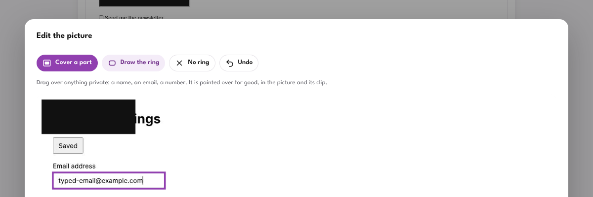

**The library**: everything you made, find a word anyone said, filter by
kind, select many.

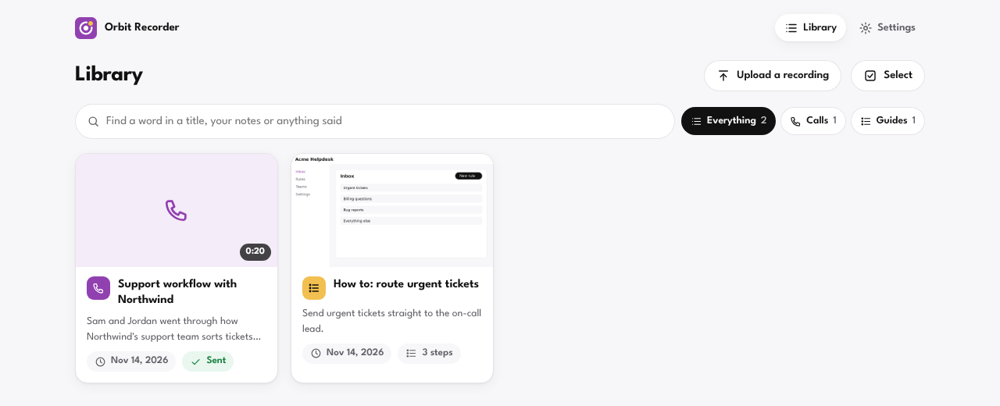

**Where things go**: add your own backend, Notion, Google Docs, Teamtailor
or HubSpot in Settings, and **Embed** gives you two lines for your own page.

<p>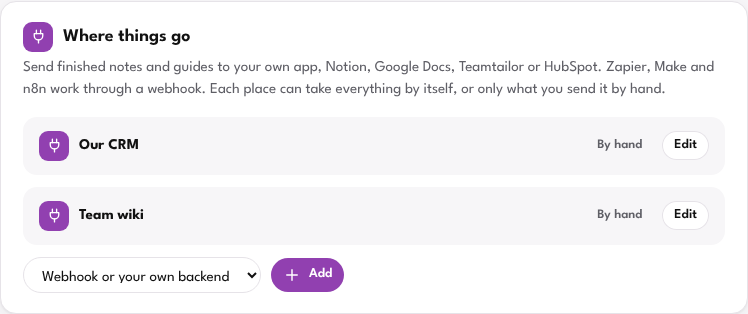 &nbsp; 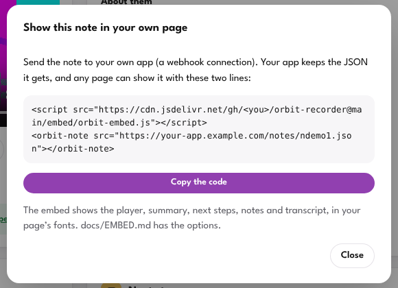</p>

**One press to start** from the popup, and **every page works on a phone-sized window**:

<p>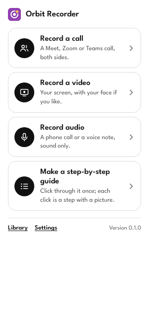 &nbsp; 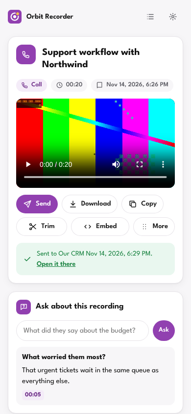 &nbsp; 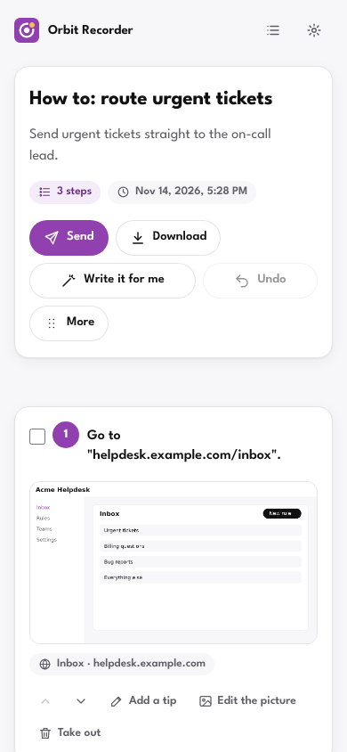 &nbsp; 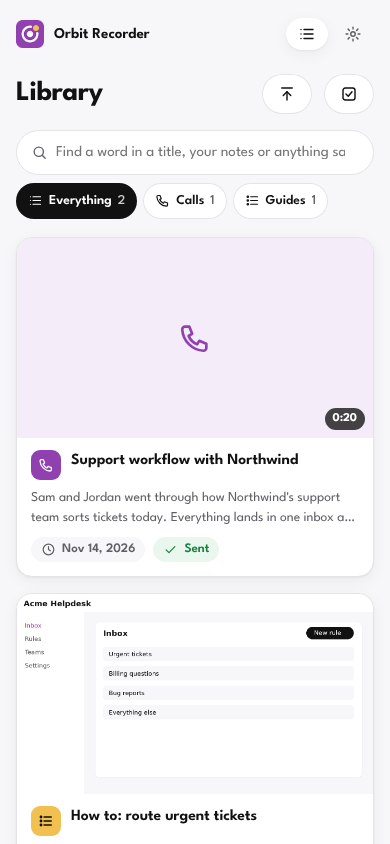</p>

## Everything it does

A full list, checked one by one against the original this was made from, is
in [docs/FEATURES.md](docs/FEATURES.md).

### Recording a call

Works on Google Meet, Zoom in the browser and Teams in the browser.

- A card at the top of the call asks **Record this meeting?**, with a
  **Video** switch (sound only, or sound and picture) that is remembered.
- **One press records both sides**: the call's sound from its tab and your
  microphone. If Chrome needs you to pick the tab, a small window opens with
  Chrome's own box.
- The **icon** or **Alt+Shift+R** on a call starts and stops it with no window at all.
- While it records, a bar shows a red dot, the time, a level for **You** and
  one for **Them**, **Pause** and **Stop**. Drag it anywhere (the spot is kept
  per site) or make it small.
- A **consent reminder** for 15 seconds: "Tell everyone on the call: I'm
  recording this call for my notes, is that OK with you?" (can be turned off).
- Warnings when **nothing is heard from the call** or **your microphone is off**, with what to do.
- **Type notes while it records**: press **Note** on the bar, write a line,
  press Enter. Each line keeps its moment and lands at the top of the note.
- **Live words** (optional, with Deepgram): the last thing said shows on the bar.
- Saved every **five seconds**: a closed tab or a crash keeps everything up to
  that moment. At the end the note opens and writes itself up.

### Recording a video

- Record **this tab** (with its sound), **a window**, **the whole screen**, or
  **part of the screen** (drag a box; it is remembered).
- **Your face in a round bubble**, drawn into the video itself.
- Pick the **camera** and **microphone** by name. One press starts a video
  with the last setup; **Change** opens the setup.
- A small **recording strip** with a live preview, the time, and a chip per
  thing captured (screen, computer sound, microphone, camera) with levels.
- Says before you start whether the computer's sound will be recorded, and
  says while recording if none is coming through.
- **Pause**, **Stop**, the icon, or Chrome's **Stop sharing**. No time limit.

### Recording audio

- **Just your voice** (a voice note, or a phone call on speaker), or **your
  voice and the computer's sound** (a call in a desktop app).

### Making a step-by-step guide

- Each **click** becomes a numbered step with a **picture taken before the
  click** and the clicked thing **ringed**. The first step is where it starts.
- Steps also come from **dropdown choices**, **keyboard shortcuts**,
  **double-clicks**, **right-clicks**, **going back**, **drags** and
  **switching tabs**. A scroll is folded into the next step.
- Each step gets **a plain sentence**: `Click "Save changes".`,
  `Enter your email in the "Email address" field.`,
  `Choose "Team" in "Plan".`, `On the "Billing" page, open the "Cards" tab.`
- A **step that moves** (a menu opens, the page scrolls, something is
  dragged) keeps a short **clip**; still steps keep a picture.
- **Typing is never recorded**; **password and card fields are painted out**
  before every picture.
- The **panel** shows the count and the last three steps, **Pause**, **Undo
  last step** and **Finish**. It is never in the pictures.
- The guide **follows you across tabs** if you allow it once.
- **Chrome's own pages** (Settings, Extensions) can be added with
  **Alt+Shift+S** or from the popup.

**Editing a guide:** change the title, intro and every sentence; **Write it
for me** rewrites them in plain words (with Undo); drag to reorder or use
Move up and Move down; add a step anywhere; a tip under any step; tick steps
and delete them together; **Undo** (also Ctrl+Z); the **picture editor**
(Cover, Draw the ring, No ring). Download as **one web page** (pictures and
clips inside), **Markdown** or **JSON**.

### The note page

- **Rename** it in place. **One player** for video or audio.
- **Trim**: drag the start and the end. Only the kept part plays, downloads
  and is sent, with the words inside it. **Make a new note from this part**
  clips a moment into its own note.
- **A write-up from a template**: Meeting, Sales or discovery call,
  Interview, One-to-one, Customer support call, Video explainer, Voice note,
  or **your own** (a name and its sections, in Settings). **Write it up
  again** with another template keeps your notes.
- **Summary** with **Short**, **In depth** and **Q&A**, plus the template's sections.
- **Next steps**: who, and when it was said; tick, edit, take out, add.
- **Who talked**: how much each voice talked, their questions and to-dos.
  Counted from the transcript, never guessed.
- **Mood**: how it felt overall, each voice's tone, and the moments it
  turned. Read from the words only.
- **Ideas** and **Chapters**, each at its moment, and **Most talked about**.
- **Ask about this recording**: an answer from this recording only, with
  times that jump the player. Your questions are kept.
- **Transcript**: every line jumps the player; **find** a word; **name each
  voice**; **"Is it you?"** names your voice in one press; **translate to
  English** with the original one press away.
- **Your notes**: an editor with headings, bold, italic, lists, checklists,
  quotes, links and a timestamp that jumps the player. Saves as you type.
- **Copy** as rich text or Markdown. **Download** as a web page, Markdown,
  JSON or the recording file. **Send** to any place you connected, and see
  where it went ("Sent to Our CRM. Open it there"). **Embed** code for your
  own page. **Archive**, **Restore** or **Delete**.

### The library

- Every call, video, voice note and guide, newest first.
- **Find** a word in a title, your notes, a summary or anything said.
- **Filter** by kind, with **Archived** kept apart.
- **Select** many: send, archive, restore or delete.
- **Upload a recording** made elsewhere: it is transcribed and written up like any other.

## Connecting it to your own system

Open **Settings → Where things go** and press **Add a place**. Each place says
what it takes (calls, videos, voice notes, guides), whether it sends **by
itself** when a note is ready or only when you press **Send**, and whether
the **recording file** goes too. You can have several at once. Chrome asks
for permission to reach each one when you add it.

A failed send is tried again after 1, 2, 4 ... minutes, up to 8 times. An
answer that says the request itself is wrong (a 4xx other than 408 and 429)
stops at once and shows why on the note.

### Your own backend or web app (webhook)

Every note is `POST`ed to your address as JSON in the
[`orbit-note/1` format](docs/FORMAT.md), and every guide as
[`step-guide/1`](docs/FORMAT.md#step-guide1).

```http
POST /hooks/orbit HTTP/1.1
Content-Type: application/json
Authorization: Bearer <your token>
X-Orbit-Event: note.finished
X-Orbit-Signature: sha256=<HMAC-SHA256 of the body with your secret>

{ "format": "orbit-note/1", "title": "Support workflow with Northwind", "summary": { ... }, "transcript": { ... }, ... }
```

With **Send the recording file too**, the request is `multipart/form-data`
with an `item` part (the same JSON) and a `media` part (the file).

Answer with any 2xx. If the answer is JSON with a `url`, the note links to it
("Open it there").

[`examples/receiver`](examples/receiver) is a working backend in one file
with no dependencies: it checks the token and the signature, keeps what it
gets, and shows it with the embed. Zapier and Make "catch hook" addresses work
here too, which reaches thousands of other apps.

### Notion

Make an [internal integration](https://www.notion.so/profile/integrations),
share a page or database with it (••• → Connections), and paste its secret
and the page link. Each note becomes a page (or a database row) with the
summary, next steps, your notes and the transcript. A guide keeps every
picture and tip. Recordings up to 20 MB are attached.

### Google Docs

Make an OAuth client in Google Cloud (type "Web application"), add the
redirect address shown in Settings, paste the client id, and press **Sign in
with Google**. Each note becomes a Google Doc, in a folder if you give one.
Only the `drive.file` permission is asked: it sees only the files it made.

### Teamtailor

Paste an API key and pick the region. A call's note is added to the
candidate's notes, found by the email on the note (the note page has a box
for it) or a default email.

### HubSpot

Paste a private app token (with the contacts scope). The note is added to the
contact found by email, the same way as Teamtailor.

### Embed it in your own page

Keep the JSON your backend received, then:

```html
<script src="orbit-embed.js"></script>

<orbit-note src="/notes/42.json" media="/notes/42.webm"></orbit-note>
<orbit-guide src="/guides/7.json"></orbit-guide>
```

It uses your page's font, shows the summary, next steps, transcript and
player (timestamps jump the player), and keeps its own styles inside a
shadow root. `hide="transcript mood"` leaves parts out, `accent="#0a7"`
changes the colour. See [docs/EMBED.md](docs/EMBED.md).

### Add a place of your own

Every place lives in [`src/destinations.js`](src/destinations.js): a label,
the fields Settings shows, the addresses it needs, and one `send(item, config)`
that returns a promise. Copy the webhook one, change `send`, and it appears in
Settings with retries, "Sent" states and select-many sending for free.

## Transcripts and write-ups

Pick them in **Settings**. Keys stay in this browser's extension storage and
are sent only to the service they belong to.

| Transcripts | Write-ups |
|---|---|
| Deepgram (also gives **live words** on calls) | Claude (Anthropic) |
| AssemblyAI | OpenAI or any compatible service (OpenRouter, Ollama, LM Studio...) |
| OpenAI Whisper | Your own service |
| Your own service | Off: write your own notes |

"Your own service" receives the recording (transcripts) or the transcript and
template (write-ups) and answers in a small JSON shape described in
[docs/FORMAT.md](docs/FORMAT.md#your-own-transcript-or-write-up-service).
A local model through Ollama keeps everything on your machine.

## Privacy

- **Nothing leaves the browser** until you add a service or a place in
  Settings. There are no analytics and no server of ours.
- **Recordings** go to the transcript service you chose; **transcripts** go
  to the write-up service you chose; **notes** go only to the places you added.
- **Guides never record typing.** Password, code and card fields are painted
  out of every picture and clip. Addresses lose their query strings, and
  links that look like private share links lose their codes.
- **Trim before sending:** a trimmed note sends only the kept part of the
  recording and only the words said inside it.
- **Recording people:** the call card reminds you to ask everyone first.
  Recording laws differ by place; it is on you to follow yours.

Full details: [PRIVACY.md](PRIVACY.md).

### Permissions

| Permission | Why |
|---|---|
| `tabCapture`, `desktopCapture`, `offscreen` | Record a call's tab, a window or the screen. |
| `activeTab`, `scripting` | Show the call card, the recording bar and the guide panel on the page you are on. |
| `storage`, `unlimitedStorage` | Keep recordings, notes, guides and settings in your browser. |
| `alarms` | Try a failed send again later. |
| `identity` | Sign in to Google, only if you add Google Docs. |
| Meet, Zoom and Teams sites | Offer to record when a call opens. |
| Other sites (optional, asked when needed) | Let a guide follow you to other tabs, and reach the services and places you add. |

## How it is built

Plain JavaScript, HTML and CSS, Manifest V3, no dependencies, no build step.

| File | What it does |
|---|---|
| `src/background.js` | The service worker: loads the parts below. |
| `src/rec-bg.js`, `src/offscreen.js`, `src/recordings.js` | Calls and audio: capture in an offscreen page, saved in 5-second pieces. |
| `src/screen.js` | Videos: screen, window, tab or part, with the face bubble and the recording strip. |
| `src/call-card.js` | The card and the bar on a call, notes typed during it, live words. |
| `src/guide-bg.js`, `src/page.js` | Guides: pictures, clips, sentences, the panel. |
| `src/note.js`, `src/guide-page.js`, `src/library.js` | The note page, the guide editor, the library. |
| `src/providers.js`, `src/templates.js`, `src/live.js` | Transcript and write-up services, templates, live words. |
| `src/destinations.js`, `src/outbox.js` | Places to send to, and sending with retries. |
| `src/format.js`, `src/export.js` | Sentences, the JSON formats, downloads. |
| `src/store.js` | IndexedDB: notes, guides, steps, recordings. |
| `embed/orbit-embed.js` | `<orbit-note>` and `<orbit-guide>` for any page. |

## Test

```sh
npm install
npx playwright install chromium
npm test
```

The test loads the real extension in Chromium and checks, on a demo site: a
guide made by clicking (sentences, nothing typed kept, clips, Undo, Pause,
following pages), editing and the picture editor, downloads, a note page with
a summary and transcript, sending to a test webhook (token, signature,
multipart with the file, retries, a 401 that stops), a trimmed note sending
only its part, the library, and the embed. Screenshots land in `test/out/`.

Recording a real call, the camera and live words need a real Chrome with a
microphone, so they are checked by hand before a release.

## Contributing

Bug reports, ideas and pull requests are welcome. Read
[CONTRIBUTING.md](CONTRIBUTING.md) first; report security problems as
described in [SECURITY.md](SECURITY.md).

## Licence

[MIT](LICENSE). Use it, change it and ship it in your own product.
